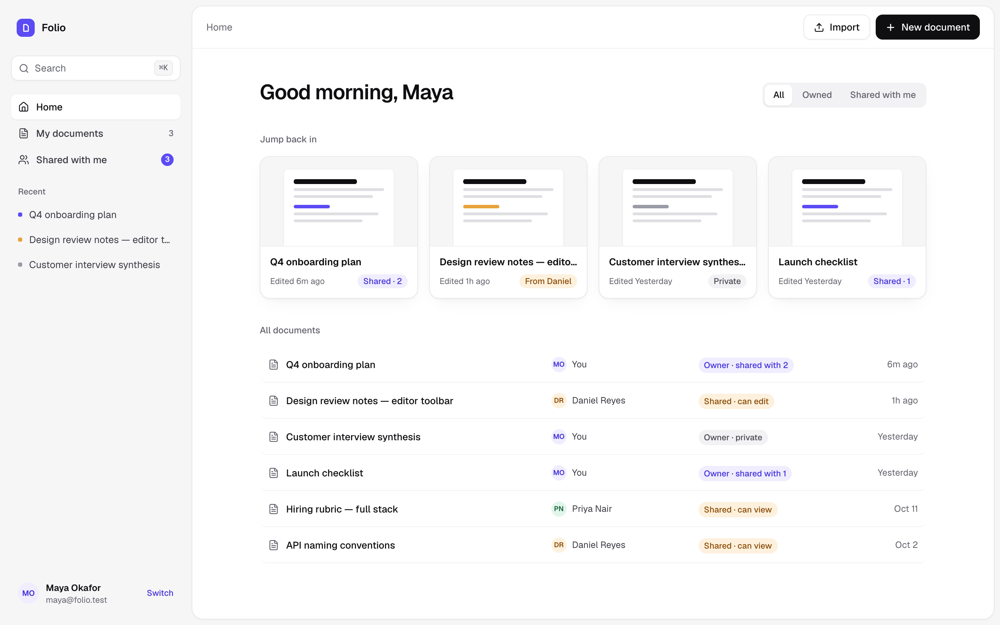

# Folio

A lightweight collaborative document editor: rich-text editing, file import, and owner-controlled sharing. Built as a 4–6 hour product-engineering exercise.

**Live demo:** https://folio-collaborative-document-editor.vercel.app · **Walkthrough video:** see [`VIDEO_URL.txt`](VIDEO_URL.txt)



## Demo accounts

Sign-in is mocked. Pick an account on the sign-in screen; no password is needed. Use **Switch** (bottom-left) to change user.

| Account | Email | Seeded data |
|---|---|---|
| Maya Okafor | `maya@folio.test` | Owns 3 docs (one shared with Daniel + Priya, one with Priya, one private) |
| Daniel Reyes | `daniel@folio.test` | Owns 2 docs shared with Maya; **editor** on Maya's "Q4 onboarding plan" |
| Priya Nair | `priya@folio.test` | Owns 1 doc shared with Maya; **viewer** on "Q4 onboarding plan", editor on "Launch checklist" |

**A 2-minute sharing check:**
1. Sign in as **Maya** and open *Q4 onboarding plan*.
2. Click **Share**. Invite `sam@folio.test` to see validation, then change Priya to *Can edit* or remove her.
3. **Switch** to **Daniel** and open the doc from *Shared with me*. He can edit, and his name shows in the footer as last editor.
4. **Switch** to **Priya**. With *Can view* access the editor is read-only and the toolbar is disabled.

## What it does

- **Documents:** create, rename (inline in the breadcrumb), edit, delete. Autosaves 800 ms after you stop typing, with a Saving… / Saved / Not saved + Retry badge.
- **Rich text (Tiptap):** bold, italic, underline, Paragraph/H1/H2/H3, bulleted and numbered lists, undo/redo, plus the usual keyboard shortcuts. Content is stored as structured JSON, so formatting survives reloads exactly.
- **File import:** `.txt`, `.md` and `.docx` up to 2 MB. Two modes:
  - **as a new document:** a leading `# Heading` becomes the title
  - **into the current draft:** appended at the end

  Other types (e.g. PDF) are rejected with a clear message. Supported types are stated in the dialog.
  Ready-made files to try are in [`docs/sample-imports/`](docs/sample-imports): a `.docx`, `.md` and `.txt` that use every supported format, plus a PDF that shows the unsupported-file message.
- **Sharing:**
  - Each document has one owner.
  - The owner invites existing users by email as **Can edit** or **Can view**, and can change roles or remove access.
  - The dashboard separates **Owned** from **Shared with me**, with colour-coded badges: violet = yours, amber = shared with you, grey = private.
- **Search:** ⌘K / Ctrl+K quick-open by title.

## Run locally

Requires **Node 20.9+**. No database account is needed locally: if `DATABASE_URL` is unset, Folio uses an embedded Postgres ([PGlite](https://pglite.dev)) stored in `./.data`.

```bash
npm install
cp .env.example .env.local      # optional locally; AUTH_SECRET is required for `npm start`
npm run db:setup                # apply migrations + seed demo users and documents
npm run dev                     # http://localhost:3000
```

| Script | What it does |
|---|---|
| `npm run dev` / `build` / `start` | Next.js dev server / production build / production server |
| `npm test` | Vitest: access-control matrix, sharing + documents integration tests on real Postgres (PGlite), import parsing |
| `npm run lint` · `npm run typecheck` | ESLint (Next + React Compiler rules) · `tsc` |
| `npm run db:setup` | Migrate + seed (works against PGlite or Neon) |
| `npm run db:seed` | Reset demo data |
| `npm run db:reset` | Delete the local PGlite database and set it up again |
| `npm run db:generate` | Generate a new SQL migration after editing `src/lib/db/schema.ts` |

> PGlite is single-process: stop `npm run dev` before running `db:*` scripts against the local database.

## Deploy (Vercel + Neon, both free tiers)

1. Import the repo in Vercel.
2. Under **Storage**, add **Neon Postgres** from the Marketplace. This sets `DATABASE_URL`.
3. Add `AUTH_SECRET` (e.g. `openssl rand -base64 32`) to the project's environment variables.
4. Migrate and seed the Neon database once, from your machine:
   ```bash
   DATABASE_URL="postgres://…" npm run db:setup
   ```
5. Deploy.

## Project structure

```
src/
  app/                    routes: /login, / (dashboard), /documents/[id], api/* route handlers
  components/ui/          design-system primitives (cva variants) + composed pieces, barrel-exported
  features/<feature>/     auth · documents · editor · sharing · import
    components/ hooks/ services/ types/   (each with an index.ts barrel)
  layout/                 app shell (sidebar, user card)
  lib/                    server + shared logic: db/, auth, access rules, documents service,
                          import parser, http errors, validations/ (Zod, shared client+server)
  stores/                 Zustand (editor save state)
  proxy.ts                Next 16 request gate (formerly middleware)
drizzle/                  SQL migrations
docs/                     ARCHITECTURE.md, AI_WORKFLOW.md, screenshots/
```

More detail: [docs/ARCHITECTURE.md](docs/ARCHITECTURE.md) · AI usage: [docs/AI_WORKFLOW.md](docs/AI_WORKFLOW.md) · Contents: [SUBMISSION.md](SUBMISSION.md)
